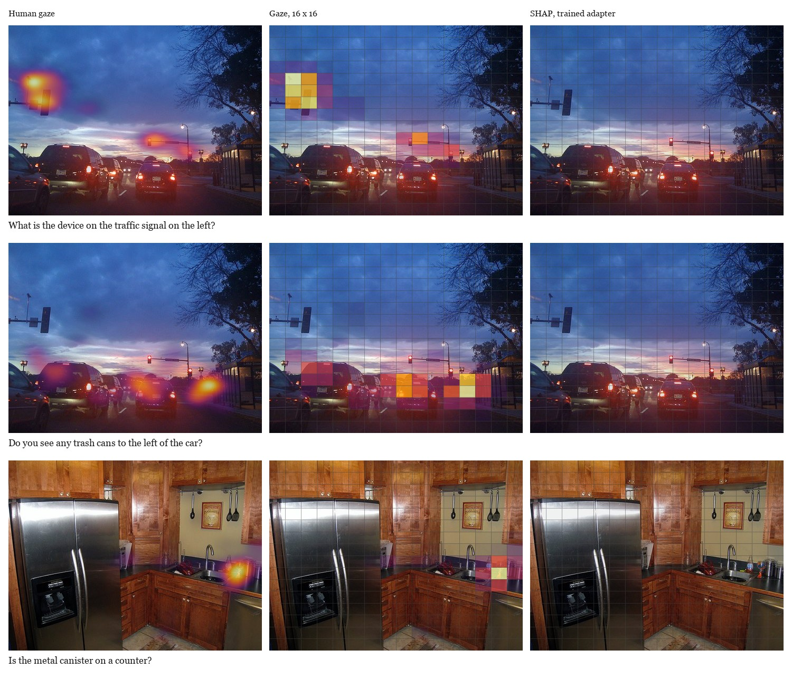
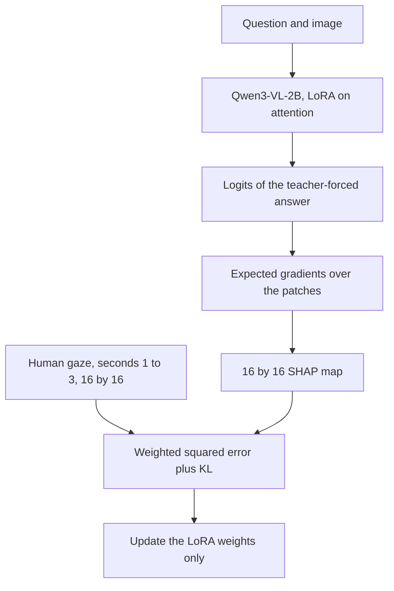

# **GazeSHAP-VQA** · SHAP on a visual question, matched to the fixation map for that question

Stage 1 trains Qwen3-VL-2B so that a differentiable SHAP map for the answer logits sits on the regions people looked at while answering the same question. Two runs on the AiR-D validation split do not clear a Gaussian at the image centre. AUC-Judd stays just above a uniform map.

| **1,422** | **987** | **0.724** | **0.539** | **0.529** |
|---|---|---|---|---|
| questions | images | centre prior, AUC-Judd | first answer token | sum of the answer tokens |

The band that matters runs from the centre prior, 0.724, to human agreement between observers, 0.895. A uniform map scores 0.500. Both runs are read against 0.724. The numbers above are validation, 155 questions, not the held-out test split.

## The map moves, and the ranking does not

The first run attributes the logit of the first answer token, at the position right after a teacher-forced `<answer>` tag. Validation AUC-Judd is 0.539, correlation 0.042, KL(gaze ‖ SHAP) 1.707. A uniform map has KL 1.62. The centre prior, which wins on AUC-Judd, has KL 8.27. The loss that was minimised and the metric that would count a result pull in different directions.

The second run keeps the same loss, the same LoRA targets, and the same 64–128 visual tokens, and attributes the sum of the logits over every token of the teacher-forced answer. Correlation rises to 0.122, close to the centre prior’s 0.136. AUC-Judd falls to 0.529. KL stays at 1.70. The adapters can move the map. They do not put the fixation locations at the top of the ranking.

The figure is the second run, the adapter at the end of that run, on three questions. Left is the fixation density from seconds 1–3. The middle column is that density pooled to the 16×16 grid the loss sees. Right is the SHAP map for the sum of the answer logits. The middle and right columns share one colour scale, set by the brightest gaze cell of that question. A uniform cell holds 0.0039 of the mass. These SHAP maps peak between 0.005 and 0.011, so the right column stays faint. On the three questions AUC-Judd is 0.664, 0.540 and 0.564. The validation mean over 155 questions is 0.529.



## How a map was produced

The question is read before the image appears. The image is on for three seconds. The first second is discarded, because the trial forces the opening fixation to the centre of the screen. Fixations in the next two seconds are drawn as Gaussians of 9 px on a 256×256 map and pooled to 16×16. Splits are cut by image, 70/10/20.



One visual token covers 32×32 pixels. `pixel_values` is a merge-window patch sequence, not an image tensor. Expected gradients use a black baseline and keep the graph, so the loss can reach the adapters. Captum’s gradient SHAP does not. The vision tower stays frozen. Attention is eager, and gradient checkpointing is off, because the loss is a second derivative.

Under the default weights the KL term is about a thousand times the weighted squared error, so both runs were driven by KL(gaze ‖ SHAP). The cluster runs used two baselines and 64–128 visual tokens so the double backward fit in GPU memory. The method as specified uses five baselines and 256–512 tokens.

A short site with the data description and this pipeline is at [acul01.github.io/GazeSHAP-VQA](https://acul01.github.io/GazeSHAP-VQA/).

## Scope

Two runs, one validation split, one backbone, LoRA only. No reasoning chain was trained, and these numbers are not test-set numbers. The loss that moved is not the metric that would place a result between 0.724 and 0.895. The runs say where this attribution sits. They do not say that the model answers from the regions that carry the answer.

## Materials

Images are Visual Genome photographs (Krishna et al., IJCV 2017, CC BY 4.0), used through GQA (Hudson and Manning, CVPR 2019). Eye tracking is AiR-D (Chen, Jiang, Yang and Zhao, ECCV 2020). The raw images and gaze archives are not in this repository.

<details>
<summary>Files and how to regenerate a run</summary>

| Path | What it holds |
|---|---|
| `src/models/shap_module.py` | Expected gradients with the graph kept |
| `src/models/patch_grid.py` | Undo the merge-window patch order |
| `src/training/losses.py` | Weighted squared error and KL(gaze ‖ SHAP) |
| `src/data/` | Download, gaze maps, image-level splits |
| `configs/stage1_shap_gaze.yaml` | The Stage 1 training config |
| `data/processed/splits/` | Train, validation, and test question ids |
| `site/` | Data and method pages, and the gaze-versus-SHAP figure above |
| `scripts/render_example_shap.py` | Renders those three SHAP maps from a Stage 1 adapter |
| `tests/` | CPU suite, including the gradient-flow check |

```bash
uv venv --python 3.11 .venv
uv pip install --python .venv/bin/python -e ".[dev]"
pytest tests/ -q --device cpu
```

On a CUDA machine, install the training extras from the cu124 index and point `PY` at that interpreter:

```bash
uv pip install --python .venv/bin/python \
  --extra-index-url https://download.pytorch.org/whl/cu124 \
  -e ".[dev,train,eval]"
python scripts/download_data.py --data-root data
python scripts/preprocess_gaze.py --data-root data
python scripts/check_double_backward.py
python scripts/train_stage1.py --config configs/stage1_shap_gaze.yaml
```

The download is about 500 MB: AiR-D, the GQA balanced validation questions extracted from a zip over HTTP range requests, and 987 Visual Genome images. `docker compose run --rm test` runs the CPU suite. A GPU image is `Dockerfile.cuda`.

</details>
