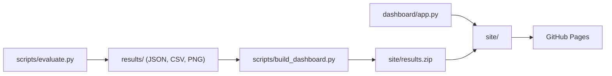

# GazeSHAP-VQA

> **Project:** Gaze-Supervised SHAP Training for Visual Question Answering
> with Explicit Reasoning Chains
> **Status:** Pre-implementation — use this file as the single source of truth.
> **Last updated:** 2026-09-25

---

## 1. Project Goal

Train a VQA model that is **right for the right reasons**: it must attend to the
same image regions that humans attend to while answering the *same question*
(captured via eye-tracking), generate an **explicit natural-language reasoning
chain** grounded in those regions, and only then produce its final answer.

This is implemented as a **three-stage pipeline with two supervision targets**:

```
Image + Question
  │
  ▼
[Stage 1 — Visual Grounding]
  Differentiable SHAP map  ←── Loss 1: align with human gaze heatmap (GT)
  │
  ▼ (gaze-aligned visual features)
[Stage 2 — Reasoning Chain]
  <think> … free-form reasoning … </think>
  │
  ▼
[Stage 3 — Answer]
  <answer> … </answer>  ←── Loss 2: answer correctness (GRPO reward)
```

**The key hypothesis:** forcing the model's SHAP attribution to match human gaze
*before* the reasoning chain is generated will (a) ground the reasoning in the
regions that actually carry the answer, and (b) reduce hallucinated rationales
that retrofit a correct answer post-hoc.

**What is being tested here is the method, not the domain.** The question is
whether "RL after gaze-supervised SHAP" works at all. The dataset is therefore
chosen to make that question answerable with as few confounds as possible, not
because the application domain is interesting in itself.

### 1.1 Why AiR-D

The method imposes three requirements on the data, and each of them eliminates
almost every eye-tracking dataset in existence:

1. **The gaze must be conditioned on the question.** The hypothesis is about
   *where the model looks in order to answer this question*. A dataset that
   recorded gaze during free viewing, or during an open-ended description task,
   yields one map per image regardless of the question. Training against it
   would silently reduce Loss 1 to a generic saliency prior and the central
   claim could never be tested.
2. **Several annotators per question.** A single observer's scanpath in a
   three-second trial is mostly noise. Without aggregation there is no stable
   target, and without a multi-observer set there is no way to estimate the
   noise ceiling that the model is being measured against.
3. **A licence that permits republication.** The deliverable includes a public
   dashboard with SHAP overlays drawn on the source images. Any dataset under a
   restricted data use agreement makes that deliverable impossible.

AiR-D satisfies all three: the question is displayed *before* the image, 20
subjects answer every question, and the images come from Visual Genome under
CC BY 4.0. It also supplies a measured inter-subject agreement (§4.2), which
becomes the upper reference line for every alignment metric in §7.3.

---

## 2. Repository Layout

```
gazeshap_vqa/
├── AGENTS.md                   ← condensed version of this file for the agent
├── pyproject.toml
├── requirements.txt
├── Dockerfile
├── .pre-commit-config.yaml
│
├── .github/
│   └── workflows/
│       ├── ci.yml              ← ruff + pytest on CPU
│       └── pages.yml           ← build dashboard, deploy to GitHub Pages
│
├── configs/
│   ├── base.yaml               ← shared hyperparameters
│   ├── stage1_shap_gaze.yaml   ← Stage 1 training (SHAP-gaze alignment)
│   ├── stage2_grpo.yaml        ← Stage 2+3 GRPO training
│   ├── eval.yaml
│   └── eval_controls.yaml      ← C1 center-prior / C2 shuffled-gaze controls
│
├── data/
│   ├── raw/
│   │   ├── images/             ← GQA images (JPG, from Visual Genome)
│   │   ├── air_d/
│   │   │   ├── aggregated_maps/   ← fixmaps, fixmaps_corr, fixmaps_incorr
│   │   │   ├── temporal_maps/     ← *_1s, *_2s bins
│   │   │   └── scanpaths/         ← fix/*.mat + consolidated_answers.json
│   │   └── gqa/                ← val_balanced_questions.json
│   ├── processed/
│   │   ├── fixation_maps/      ← per-question maps downsampled to PxP (NPY)
│   │   └── splits/             ← train.json, val.json, test.json
│   └── README.md               ← data provenance and licence notes
│
├── src/
│   ├── __init__.py
│   ├── data/
│   │   ├── __init__.py
│   │   ├── dataset.py          ← GazeVQADataset (torch.utils.data.Dataset)
│   │   ├── air_d.py            ← AiR-D loaders: .mat scanpaths, map files
│   │   ├── gaze_preprocessing.py  ← scanpaths/maps → PxP fixation grids
│   │   ├── splits.py           ← image-level train/val/test partitioning
│   │   └── collate.py          ← custom collate_fn for variable-size images
│   │
│   ├── models/
│   │   ├── __init__.py
│   │   ├── vlm_wrapper.py      ← wraps Qwen3-VL-2B; enforces eager attention
│   │   ├── patch_grid.py       ← flat Qwen patch sequence ↔ spatial (gh, gw) grid
│   │   ├── shap_module.py      ← differentiable expected gradients
│   │   └── reasoning_head.py   ← prompt formatting for <think>/<answer>
│   │
│   ├── training/
│   │   ├── __init__.py
│   │   ├── losses.py           ← L_align (W-MSE / KL-div)
│   │   ├── rewards.py          ← GRPO reward functions (answer + format + gaze)
│   │   ├── stage1_trainer.py   ← supervised SHAP-gaze alignment trainer
│   │   └── stage2_grpo.py      ← GRPO trainer extending TRL GRPOTrainer
│   │
│   ├── evaluation/
│   │   ├── __init__.py
│   │   ├── metrics.py          ← VQA accuracy (GQA normalisation), format rate
│   │   ├── gaze_alignment.py   ← AUC-Judd, CC, NSS, KL between maps
│   │   ├── faithfulness.py     ← Insertion / Deletion benchmarks
│   │   ├── controls.py         ← center-prior and shuffled-gaze references
│   │   └── artifacts.py        ← writes everything under results/
│   │
│   └── utils/
│       ├── __init__.py
│       ├── visualization.py    ← overlay SHAP map on image, save PNG
│       ├── logging_utils.py    ← W&B + local logging helpers
│       └── config.py           ← Pydantic config loader
│
├── slurm/
│   ├── setup_env.sh            ← venv + CUDA wheels on the compute node
│   └── stage1.sbatch           ← single A100 40GB Stage 1 job
│
├── scripts/
│   ├── download_data.py        ← fetch AiR-D + GQA, verify checksums
│   ├── preprocess_gaze.py      ← CLI: AiR-D maps/scanpaths → fixation_maps/
│   ├── make_splits.py          ← CLI: image-level train/val/test partitioning
│   ├── train_stage1.py         ← CLI: run Stage 1 SHAP-gaze alignment
│   ├── train_stage2.py         ← CLI: run Stage 2 GRPO
│   ├── evaluate.py             ← CLI: full evaluation suite → results/
│   └── build_dashboard.py      ← pack results/ into dashboard payload
│
├── results/                    ← static, committed evaluation artefacts
│   ├── metrics.json
│   ├── curves/
│   ├── examples/
│   └── manifest.json
│
├── dashboard/
│   ├── app.py                  ← Streamlit entrypoint (Pyodide-safe only)
│   ├── pages/
│   ├── index.html              ← stlite mount
│   └── requirements.txt        ← pure-Python wheels only
│
├── tests/
│   ├── test_config.py
│   ├── test_gaze_preprocessing.py
│   ├── test_patch_grid.py
│   ├── test_shap_module.py
│   ├── test_losses.py
│   ├── test_rewards.py
│   ├── test_dataset.py
│   ├── test_controls.py
│   └── test_artifacts.py       ← results/ schema validation
│
└── notebooks/
    ├── 01_explore_air_d.ipynb
    ├── 02_shap_map_sanity_check.ipynb
    └── 03_qualitative_results.ipynb
```

---

## 3. Tech Stack & Key Dependencies

| Purpose                    | Library / Version                                   |
| -------------------------- | --------------------------------------------------- |
| Base VLM                   | `Qwen/Qwen3-VL-2B-Instruct` (HF Hub)                |
| Differentiable attribution | custom `expected_gradients` (see §5.2)              |
| Attribution cross-check    | `captum >= 0.7` (tests only)                        |
| Kernel SHAP (eval only)    | `shap >= 0.45`                                      |
| GRPO training              | `trl >= 0.9` (`GRPOTrainer`)                        |
| Deep learning              | `torch >= 2.3`, `torchvision >= 0.18`               |
| VLM inference/fine-tuning  | `transformers >= 4.57`, `peft >= 0.12` (LoRA)       |
| Config management          | `pydantic >= 2.0`, `omegaconf >= 2.3`               |
| Experiment tracking        | `wandb >= 0.17`                                     |
| Gaze preprocessing         | `scipy >= 1.13`, `opencv-python >= 4.10`            |
| Data                       | `datasets >= 2.20`, `Pillow >= 10`                  |
| Evaluation                 | `torchmetrics >= 1.4`, `scikit-image >= 0.24`       |
| Dashboard                  | `streamlit >= 1.40`, `altair >= 5`, `stlite-cli`    |
| Testing                    | `pytest >= 8`, `pytest-cov`                         |

`scipy.io.loadmat` is required for the AiR-D scanpath `.mat` files — it is
already a dependency, but do not swap `scipy` for a lighter alternative.

### Also use

- Docker
- YAML configs
- `ruff` + pre-commit hooks

**Python:** 3.11+
**CUDA:** 12.x. Target hardware is a single **A100 40GB**; code must degrade
gracefully to CPU for unit tests.

Install:

```bash
pip install -e ".[dev]"
```

---

## 4. Data Specification

### 4.1 Sources

Two downloads, neither requiring registration or credentialing.

**AiR-D** — human eye-tracking for VQA, from
[szzexpoi/AiR](https://github.com/szzexpoi/AiR) (Chen, Jiang & Zhao).
Two Google Drive archives linked in the repository README:

- Saliency maps: `aggregated_maps/` and `temporal_maps/`
- Raw scanpaths: `fix/*.mat` plus `consolidated_answers.json`

**GQA** — questions, answers and images, from
[cs.stanford.edu/people/dorarad/gqa](https://cs.stanford.edu/people/dorarad/gqa/).
Only `val_balanced_questions.json` and the corresponding images are needed;
AiR-D questions are a curated subset of the balanced validation split.

`scripts/download_data.py` must fetch both, verify sizes, and fail loudly rather
than silently producing a partial dataset.

**Neither GQA bulk archive is downloaded in full.**

- `questions1.2.zip` is 1.5 GB and holds every split; we need one file from it.
  The server sends `Accept-Ranges: bytes`, so the script reads the
  zip central directory over HTTP and extracts `val_balanced_questions.json`
  alone (~50 MB). `--full-questions-zip` restores the naive path.
- `images.zip` is **21.8 GB** and we need 987 images. GQA image IDs are Visual
  Genome image IDs, so the images are fetched individually from
  `https://cs.stanford.edu/people/rak248/VG_100K/{image_id}.jpg`, falling back to
  `VG_100K_2` for the second half of the corpus. That is roughly 100 MB.

### 4.2 What AiR-D actually contains

| Property | Value |
| --- | --- |
| Images | 987 |
| Questions | 1,422 |
| Images with >= 2 questions | 299 |
| Participants per question | 20 (16 m / 4 f, ages 18-38) |
| Eye tracker | Vive Pro Eye, integrated |
| Image presentation | 3 s, centred, 30 degrees visual angle |
| Fixation extraction | Cluster Fix algorithm |
| Map resolution | 256 x 256 |
| Smoothing | Gaussian, sigma = 9 px (~1 DVA) |
| Normalisation | to [0, 1] |
| Mean fixations per trial | 10.12 (correct) / 10.27 (incorrect) |
| Human answer accuracy | 77.64% +- 24.55% |
| Questions with all-correct answers | 479 |
| Questions with mixed answers | 934 |
| **Inter-subject consistency** | **AUC-Judd = 0.895** |

**The trial procedure is what makes this dataset usable for us.** The question is
displayed first, the participant reads it for as long as they want, then presses
a button to reveal the image for exactly three seconds, then answers. The gaze is
therefore *conditioned on the question*, which is requirement 1 from §1.1 and the
reason this dataset was chosen.

Question screening (done by the AiR authors): image at least 320x320, scene graph
with at least 16 relationships, and total area of question-relevant objects at
most 4% of the image. The questions are non-trivial and require active search.

Files are named by the GQA `qid`. Join to GQA's question JSON on that key to get
`imageId`, `question`, `answer`, `fullAnswer` and `semantic` (the functional
program).

**Hold-out test set.** AiR-D also defines 319 images / 406 questions with human
accuracy 65.42% +- 26.38%. Its eye-tracking data is withheld: the two Drive
archives linked under "Benchmarking with AiR-D" contain only GQA IDs and
question-answer pairs, and the repository README states the fixations are kept
private for evaluation by the authors. In issue #5 (last comment 2025-06-28) the
first author said the data would be released, but as of this writing it has not
been. Treat the hold-out as **optional metadata**: `scripts/download_data.py`
must not fail if it is absent, and the default splits must not depend on it.

### 4.3 Fixation Map Generation (`src/data/gaze_preprocessing.py`)

Two code paths, both producing the same output format.

**Path A — from the aggregated maps (default).** Load the 256x256 PNG/NPY map for
a `qid`, then downsample to the patch grid.

**Path B — from raw scanpaths (`--from-scanpaths`).** Reproduce the aggregation
so that per-subject maps become available for augmentation:

1. Load `fix/{qid}/{subject}.mat`; read `xy` (fixation locations) and `t`
   (start/end times per fixation)
2. Filter to the selected temporal bins (see below)
3. Rescale `xy` from **original image pixels** into the 256x256 map, then place a
   2D Gaussian at each location with `sigma = GAZE_SIGMA_PX = 9`, weighted by
   fixation duration
4. Sum, then normalise to a probability distribution
5. Aggregate over subjects: element-wise mean, **after** per-subject maps are
   summed but **before** the final normalisation

**What the archives actually contain**, established by inspection and recorded
in `data/README.md`; the loaders depend on it:

- Scanpaths are `fix/{qid}/{subject}.mat`, one directory per question — not the
  flat `fix/{qid}_{subject}.mat` the upstream README suggests.
- **Ten** subjects per question, twenty in total. `consolidated_answers.json` is
  keyed by field (`accuracy`, `question`, `answer`, plus one key per
  participant), and `accuracy` is always a multiple of 0.1. The "20 participants
  per question" figure in §4.2 is the participant pool, not the per-question count.
- `xy` is in original image pixel coordinates, so the rescale in step 3 needs the
  image, and `t` is in milliseconds within the 3,000 ms trial.
- 313 of 14,220 trials recorded no usable fixation and are treated as empty.
- `fixmaps` ships 1,454 maps but only 1,422 questions have temporal bins,
  scanpaths and responses. The canonical question set is the intersection.

**Validation.** Reconstructing the whole-trial map from scanpaths reproduces the
shipped one at **CC 0.96** on the 16x16 training grid (150 questions), which is
the check `scripts/preprocess_gaze.py --validate` performs. The correlation peaks
at an effective sigma near 13 rather than the documented 9; the default stays at
9 because that is the published value and the difference is immaterial once the
map is pooled to 16x16.

**Temporal binning is not optional.**
AiR-D provides `temporal_maps` in 1-second bins, and the first second is heavily
centre-biased by construction: the experiment aligns the initial fixation with
the image centre, and the paper measures CC 0.47 against a centre prior in the
first second versus 0.15 afterwards. Using the full three seconds would mean
training the model to reproduce an experimental artefact.

```python
TEMPORAL_BINS = ("1s", "2s")  # discard 0-1s; CLI flag --bins to override
GAZE_SIGMA_PX = 9  # matches AiR-D (~1 DVA)
PATCH_GRID_SIZE = 16  # matches the SHAP map resolution
MAP_SIZE = 256  # AiR-D native resolution
```

Downsample to the patch grid with `cv2.resize(..., interpolation=cv2.INTER_AREA)`
and renormalise afterwards so the grid sums to 1.0. Save to
`data/processed/fixation_maps/{qid}.npy`.

**Correctness filtering.** `--use-correct-only` selects `fixmaps_corr` instead of
`fixmaps`, keeping only the attention patterns of subjects who actually got the
answer right. This is the cleaner supervision target in principle, but it also
shrinks and biases the sample. Report both in the ablations; do not assume one
is better.

There is no minimum-annotator threshold to configure — every question has 20.

### 4.4 Splits (`src/data/splits.py`)

Partition **by image**, 70/10/20, with `seed = 42`. Splitting by question would
leak: 299 images carry more than one question, and the model would see the same
scene in train and test.

Write `data/processed/splits/{train,val,test}.json` as lists of `qid`. The split
files are committed to the repository so that results are reproducible without
redistributing any data.

### 4.5 Answer Format

GQA answers are **open-vocabulary short strings** (`yes`, `no`, `left`, `wood`,
`skateboard`), not multiple-choice letters. The spec therefore uses exact match
after GQA's standard normalisation (lowercase, strip punctuation and articles) —
this is the official GQA metric and avoids fabricating synthetic distractors.

A multiple-choice variant remains available as an ablation via
`--answer-format=mc`, which samples three distractors from the answer vocabulary
of the same GQA question type. It is **off by default**.

### 4.6 Dataset Class (`src/data/dataset.py`)

`GazeVQADataset` must return:

```python
{
    "pixel_values": torch.Tensor,  # (n_patches, C*temporal*16*16) flat Qwen patches
    "image_grid_thw": torch.LongTensor,  # (3,) = (t, grid_h, grid_w)
    "input_ids": torch.LongTensor,  # tokenised prompt, ending in "<answer>"
    "attention_mask": torch.LongTensor,
    "mm_token_type_ids": torch.LongTensor,  # 1 at image-token positions; M-RoPE needs it
    "gaze_map": torch.FloatTensor,  # (P, P) normalised fixation map
    "target_token_id": torch.LongTensor,  # first token of the ground-truth answer
    "answer_str": str,  # GQA answer, e.g. "yes"
    "question": str,
    "qid": str,
    "image_id": str,
    "subject": str,  # "" unless per-subject augmentation is on
}
```

`mm_token_type_ids` is not optional on `transformers >= 5`: `Qwen3VLModel`
raises if multimodal inputs arrive without it, because M-RoPE cannot place the
visual tokens otherwise.

Batching (`src/data/collate.py`) concatenates `pixel_values` along dim 0 across
the batch and stacks `image_grid_thw` into `(B, 3)`, which is the layout the
model expects given that the patch count varies per image. Token sequences are
**left**-padded so that the final position is the attribution target for every
sample in the batch.

### 4.7 Data Volume — a first-class risk

1,422 questions is small. This is the single biggest threat to a clean result and
must be treated as such throughout:

- Train LoRA adapters only; never full fine-tuning.
- Report mean and standard deviation over **at least 3 seeds** for every number
  that appears in a conclusion.
- Use per-subject maps (Path B) as Stage 1 augmentation: 20x the supervision
  pairs at the cost of noisier targets. Enable with `--per-subject-augment`.
- Do not read anything into differences smaller than the seed-to-seed spread.

---

## 5. Model Architecture

### 5.1 Backbone: `VLMWrapper` (`src/models/vlm_wrapper.py`)

- Load `Qwen/Qwen3-VL-2B-Instruct` via `Qwen3VLForConditionalGeneration`.
  Fallback if the architecture causes trouble with double backward:
  `Qwen/Qwen2.5-VL-3B-Instruct`, which has a simpler vision path.
- **`attn_implementation="eager"` is mandatory.** See §10.2.
- Apply **LoRA** to all attention projection layers (`q_proj`, `k_proj`,
  `v_proj`, `o_proj`) with `r=16, lora_alpha=32, lora_dropout=0.05`.
- Keep the vision encoder frozen in Stage 1; unfreeze its LoRA layers in Stage 2.
- Bound the number of visual tokens via the processor: `min_pixels = 256*32*32`,
  `max_pixels = 512*32*32`. Dynamic resolution is otherwise unbounded, and Stage 1
  memory scales with the visual sequence length.
  **The unit is 32x32, not the 28x28 of the Qwen2-VL family.** Qwen3-VL's vision
  config has `patch_size = 16` and `spatial_merge_size = 2`, so one visual token
  covers 32x32 pixels. Using `N*28*28` would silently yield ~0.77*N tokens.
- Expose `target_logit(outputs, target_token_id) -> Tensor` returning the scalar
  logit that attribution is computed against.

### 5.2 SHAP Module (`src/models/shap_module.py`)

#### Training: differentiable expected gradients

**Do not use `captum.attr.GradientShap` in the training loop.** `L_align` is a
function of `d(logit)/d(pixel)`, so its gradient with respect to the model
parameters is a second derivative, `d^2(logit)/d(pixel)d(theta)`. Captum calls
`backward()` internally without `create_graph=True`, so the attribution it
returns is a leaf with respect to the parameters and no gradient reaches the LoRA
weights. This fails silently — the loss decreases in the logs while nothing is
learned. Implement expected gradients directly:

```python
class DifferentiableSHAPModule(nn.Module):
    def __init__(self, vlm_wrapper, patch_grid_size=16, n_baselines=5, baseline="black"): ...

    def forward(
        self, pixel_values, image_grid_thw, input_ids, attention_mask,
        target_token_id, create_graph=True,
    ) -> torch.Tensor:
        """
        Returns shap_map: (B, P, P) — spatial attribution over the patch grid,
        normalised to a probability distribution (softmax over P*P).
        Gradients flow back through this map into the VLM LoRA parameters
        when create_graph=True.
        """
        attr = 0.0
        for k in range(self.n_baselines):
            b = self._baseline(pixel_values, k)        # (n_patches, patch_dim)
            a = torch.rand(pixel_values.shape[0], 1, device=pixel_values.device)
            x = (b + a * (pixel_values - b)).requires_grad_(True)
            logit = self.vlm.target_logit(
                self.vlm(x, image_grid_thw, input_ids, attention_mask), target_token_id
            )
            (g,) = torch.autograd.grad(logit.sum(), x, create_graph=create_graph)
            attr = attr + g * (pixel_values - b)
        attr = attr / self.n_baselines                 # (n_patches, patch_dim)
        per_patch = attr.sum(dim=-1)                   # (n_patches,)
        grid = unflatten_patch_grid(per_patch, image_grid_thw)  # (B, gh, gw)
        pooled = F.adaptive_avg_pool2d(grid.unsqueeze(1), self.P).squeeze(1)
        return F.softmax(pooled.flatten(1), dim=-1).view(-1, self.P, self.P)
```

Four notes on this design:

- **`pixel_values` is not an image tensor.** The Qwen processor emits a flat
  patch sequence of shape `(sum_i grid_h_i * grid_w_i, C * temporal_patch * 16 * 16)`,
  and the patch order is *merge-window interleaved*: it comes from
  `patches.permute(0, 2, 5, 3, 6, 1, 4, 7)` over
  `(B, C, gh/m, m, p, gw/m, m, p)` in `image_processing_qwen2_vl.py`. A naive
  `view(gh, gw)` therefore scrambles the map. The inverse lives in
  `src/models/patch_grid.py`:

  ```python
  grid = flat.view(gh // m, gw // m, m, m).permute(0, 2, 1, 3).reshape(gh, gw)
  ```

  `tests/test_patch_grid.py` verifies it against the real processor by feeding a
  horizontal ramp and asserting the recovered grid is monotonic in x.
- **Attribution is taken with respect to `pixel_values`, not image tokens.**
  This keeps the module model-agnostic and sidesteps Qwen3-VL's DeepStack
  routing, where ViT features are injected at several decoder depths and there is
  no single clean token-to-patch mapping. Because `pixel_values` is already
  patch-shaped, summing over `patch_dim` yields one scalar per 16x16 patch
  directly; the sum also covers the two identical temporal-patch copies the
  processor emits for a still image.
- Channel aggregation is `sum` (signed) by default. `--attr-agg=abs` is an
  ablation; unsigned attributions tend to look better and mean less.
- `create_graph=False` in Stage 2. The gaze reward is a scalar handed to GRPO,
  and nothing backpropagates through it, so double backward is unnecessary there.
  This makes Stage 2 far cheaper than Stage 1 despite generating G candidates.

#### Evaluation only: KernelSHAP

Use `shap.maskers.Image` with `shap.Explainer` and the `"partition"` algorithm for
full-resolution post-hoc analysis in the eval suite. This path is **not**
differentiable and must **never** be called during training.

#### Cross-check

`tests/test_shap_module.py` compares `expected_gradients(create_graph=False)`
against `captum.attr.GradientShap` on a tiny synthetic model and asserts they
agree within tolerance. This is the only place captum appears.

### 5.3 Reasoning Head / Prompt Format (`src/models/reasoning_head.py`)

System prompt (constant):

```
You are a careful visual reasoner. When answering a question about an image,
first describe your visual reasoning step by step inside <think>...</think>
tags, focusing only on the image regions relevant to the question. Then give
your final answer inside <answer>...</answer> tags, using as few words as
possible.
```

Input format per sample:

```
<image>
Question: {question}
```

Expected output format:

```
<think>
{free-form reasoning, 2-5 sentences}
</think>
<answer>{short answer}</answer>
```

Parsing: extract with `r"<answer>\s*(.*?)\s*</answer>"`, then apply GQA
normalisation. A format violation counts as an incorrect answer in the reward.

---

## 6. Training Pipeline

### 6.1 Stage 1 — SHAP-Gaze Alignment (`scripts/train_stage1.py`)

**Objective:** minimise the distance between the model's SHAP attribution map and
the human fixation heatmap, without requiring labelled reasoning chains.

**Loss — weighted MSE:**

```python
def loss_align(shap_map: Tensor, gaze_map: Tensor, alpha: float = 1.1) -> Tensor:
    """
    shap_map: (B, P, P) softmax-normalised SHAP distribution
    gaze_map: (B, P, P) normalised fixation distribution
    alpha:    weight-sharpening constant (> 1.0)
    """
    weights = 1.0 / (alpha - gaze_map.clamp(max=alpha - 1e-6))
    return (weights * (shap_map - gaze_map).pow(2)).mean()
```

Auxiliary KL divergence:

```python
def loss_kl(shap_map, gaze_map, eps=1e-8):
    return F.kl_div((shap_map + eps).log(), gaze_map + eps, reduction="batchmean")
```

```
L_stage1 = L_W-MSE + lambda_kl * L_KL
```

Default `lambda_kl = 0.1`.

**The two terms are not on the same scale, and the default weighting makes the
KL term dominant.** Both maps are distributions over P*P = 256 cells, so a
typical cell holds ~0.004 and the squared errors the W-MSE averages are of order
1e-5. A first real run measured `loss_align ~ 1e-4` against
`lambda_kl * loss_kl ~ 0.15`: the weighted MSE contributes roughly 0.1% of the
gradient signal. That is a calibration decision, not a bug, but it must be made
deliberately — either raise `lambda_kl`'s counterpart by scaling `L_W-MSE`, or
accept that Stage 1 is effectively KL-driven and say so.

**Trainer:** plain `torch` loop, `AdamW`, cosine schedule, `lr = 2e-4`,
`weight_decay = 0.01`, `warmup_steps = 50`, `N_EPOCHS_STAGE1 = 5`. Evaluate on
val every epoch using `KL(SHAP || gaze)` and AUC-Judd.

**A100 40GB settings.** Double backward roughly triples activation memory, and
gradient checkpointing cannot be used (§10.2):

```yaml
per_device_train_batch_size: 2
gradient_accumulation_steps: 8
n_baselines: 5
max_pixels: 401408          # 512 * 28 * 28
attn_implementation: eager
bf16: true                  # attribution itself runs in fp32, see §10.4
```

Save to `checkpoints/{run_id}/stage1_best.pt` on best val KL.

### 6.2 Stage 2 — GRPO with Dual Rewards (`scripts/train_stage2.py`)

Extends `trl.GRPOTrainer`, initialised from the Stage 1 checkpoint.

```python
def reward_answer_correctness(completions, answer_str, **kwargs) -> list[float]:
    """1.0 if the GQA-normalised extracted answer matches GT, else 0.0."""


def reward_format(completions, **kwargs) -> list[float]:
    """1.0 if <think>...</think><answer>...</answer> is well formed, else 0.0."""


def reward_gaze_alignment(
    completions, pixel_values, input_ids, gaze_map, shap_module, **kwargs
) -> list[float]:
    """
    Compute the SHAP map for the generated answer's first token with
    create_graph=False, return negative KL vs. gaze_map, clipped to
    [-2.0, 0.0] and rescaled to [0.0, 1.0].
    """
```

```
r_total = lambda_ans * r_answer + lambda_fmt * r_format + lambda_gaze * r_gaze
```

Defaults: `lambda_ans = 1.0`, `lambda_fmt = 0.2`, `lambda_gaze = 0.5`. The format
reward carries real weight here: with open-vocabulary answers there is no fixed
token set to fall back on, so a model that drops the tag structure becomes
unparseable rather than merely untidy.

**GRPO config** (`configs/stage2_grpo.yaml`, tuned for A100 40GB):

```yaml
num_generations: 6
max_new_tokens: 256
temperature: 0.9
learning_rate: 5.0e-6
per_device_train_batch_size: 2
gradient_accumulation_steps: 4
num_train_epochs: 3
use_vllm: false             # the SHAP reward needs the live model instance
```

**LoRA:** unfreeze the vision encoder LoRA layers at Stage 2 start.

---

## 7. Baselines, Controls and Success Criteria

This section exists so that "the results are positive" is decidable before any
training runs, rather than negotiated afterwards.

### 7.1 Baselines

| ID | Description |
| --- | --- |
| `B0` | Zero-shot Qwen3-VL-2B-Instruct, no training |
| `B1` | GRPO only (answer + format reward), no gaze supervision |
| `B2` | Stage 1 only (SHAP-gaze alignment), no GRPO |
| `B3` | Full pipeline: Stage 1 then GRPO with the dual reward |

`B1` is the baseline that matters. If `B3` does not beat `B1`, the gaze
supervision contributed nothing.

### 7.2 Controls

| ID | Description | What it rules out |
| --- | --- | --- |
| `C1` | Centre prior: gaze replaced by a Gaussian (sigma = 15) at the image centre | That the gain is just centre bias |
| `C2` | Shuffled gaze: gaze map taken from a different question | That question-specificity is actually used |

`C1` is not optional. Human fixations are strongly centre-biased, and a model
that learns "look at the middle" will score well on every saliency metric without
having learned anything about the question. The AiR authors use exactly this
control, with a Gaussian of sigma = 15 at the image centre.

`C2` is the sharper test. Because 299 AiR-D images carry more than one question,
the shuffled map should preferably come from a *different question about the same
image*, which isolates question-conditioning from scene-level saliency.

### 7.3 Reference values

Every gaze-alignment plot must draw two horizontal reference lines:

- **Human ceiling: AUC-Judd = 0.895.** This is the inter-subject consistency
  measured by splitting the participants in half. No model should be expected
  to exceed it, and a model close to it is at the noise floor of the data.
- **Centre-prior floor:** the `C1` score on the same metric. The AiR paper reports
  CC 0.47 against the centre prior in the first second and 0.15 afterwards, which
  is also a sanity check that the temporal binning in §4.3 is working.

**Measured on our test split** (272 questions, 16x16 grids, bins 1s+2s):

| Reference | AUC-Judd | CC | NSS | KL |
| --- | --- | --- | --- | --- |
| Uniform | 0.500 | 0.000 | 0.000 | 1.624 |
| `C1` centre prior (sigma 15) | 0.724 | 0.136 | 0.352 | 8.272 |
| Human ceiling (AiR-D) | 0.895 | - | - | - |

**The usable band is therefore 0.724 to 0.895 on AUC-Judd**, which is narrower
than it looks on a 0-to-1 axis. Any reported gain must be read against 0.724,
not against 0.5. Note also that the centre prior's KL is *worse* than uniform's:
a peaked wrong guess is punished harder by KL than a flat one, so KL and
AUC-Judd can move in opposite directions and both must be reported.

### 7.4 Decision rule

Write a paper if **all three** hold, each over at least 3 seeds with paired
bootstrap confidence intervals on the test split:

1. `B3` beats both `B0` and `C1` on AUC-Judd, with non-overlapping 95% CIs.
2. `B3` accuracy is **not more than 1 percentage point below** `B1`. Gaze
   supervision that buys grounding by losing accuracy is not an interesting
   result.
3. `B3` Insertion-AUC is **not below** `B1`. A SHAP map that matches gaze but no
   longer reflects what the model actually uses is a faithfulness regression,
   and publishing it would be the exact failure mode this project claims to fix.

Otherwise the project stays a portfolio repository — with the negative result
written up honestly, since a well-controlled negative on the faithfulness gap is
more useful than a weakly controlled positive.

---

## 8. Evaluation Protocol (`scripts/evaluate.py`)

Run all four dimensions on the held-out test split, for every run in §7.1-7.2.

### 8.1 VQA Performance

- **Accuracy:** GQA exact match after normalisation
- **Accuracy by question type:** using GQA's `types.structural` and
  `types.semantic` fields, so a gain can be attributed to a question category

### 8.2 Gaze-SHAP Alignment

Computed on the full test split with expected gradients, and additionally with
post-hoc KernelSHAP on 100 samples as a cross-check:

- **AUC-Judd** (primary) — up
- **CC** — Pearson correlation between flattened maps — up
- **NSS** — normalised scanpath saliency — up
- **KL divergence** `KL(SHAP || gaze)` — down

Reference implementation: `src/evaluation/gaze_alignment.py`. Each metric is also
computed against the `C1` centre prior and reported side by side.

### 8.3 Faithfulness

- **Insertion:** progressively reveal top-SHAP patches, measure accuracy-curve AUC — up
- **Deletion:** progressively mask top-SHAP patches, measure accuracy-curve AUC — down
- **ROAR:** not required for v1

Reference: `src/evaluation/faithfulness.py`.

### 8.4 Reasoning Chain Quality

- **Format compliance rate:** share of outputs matching the expected tag structure
- **Answer-reasoning consistency:** whether the reasoning chain's conclusion
  matches the extracted answer (LLM judge; optional for v1)

### 8.5 Output contract

`evaluate.py` must write every number it computes into `results/` via
`src/evaluation/artifacts.py`, and must never be a prerequisite for viewing them.
The schema is fixed in §9.2 and validated by `tests/test_artifacts.py`.

---

## 9. Results Artefacts and Dashboard

### 9.1 The one hard rule

**The dashboard performs no model inference.** It reads static files and renders
them. This is not a stylistic preference: the dashboard runs under Pyodide in the
browser, where `torch` and `transformers` are unavailable. Any code path that
needs them makes the dashboard undeployable.



### 9.2 Artefact schema (`results/`)

```
results/
├── manifest.json          ← schema version, git commit, timestamps, seed list
├── metrics.json           ← one record per (run_id, seed)
├── curves/
│   ├── insertion_{run_id}.csv      ← fraction_revealed, accuracy
│   ├── deletion_{run_id}.csv       ← fraction_masked, accuracy
│   └── training_{run_id}.csv       ← step, loss_align, loss_kl, reward_*
└── examples/
    ├── index.json                  ← qid, question, gt, predictions per run
    └── {qid}_{run_id}.png          ← image | gaze overlay | SHAP overlay | diff
```

`metrics.json` records, per run and seed: `accuracy`, `accuracy_by_type`,
`auc_judd`, `cc`, `nss`, `kl`, `insertion_auc`, `deletion_auc`,
`format_compliance`, plus the `C1` reference values for the alignment metrics.

Keep `results/examples/` to roughly 40 samples, images downscaled to 384 px on the
long edge. The whole directory should stay in the low single-digit megabytes so it
can be committed and shipped to the browser.

### 9.3 Licensing — why this works here

GQA images come from Visual Genome under **CC BY 4.0**. SHAP overlays on them may
be published, provided attribution is given. The dashboard footer and
`data/README.md` must credit Visual Genome, GQA (Hudson & Manning) and AiR-D
(Chen, Jiang & Zhao).

This is requirement 3 from §1.1 paying off. Under a restricted data use
agreement, none of `results/examples/` could have been published, and the
dashboard would have been reduced to aggregate numbers.

### 9.4 Dashboard implementation (`dashboard/`)

Runtime is [stlite](https://stlite.net/browser/), which runs Streamlit in the
browser via Pyodide. Pin `@stlite/browser@0.85.1`.

`dashboard/requirements.txt` may contain **pure-Python wheels or wheels Pyodide
ships** — in practice `pandas`, `altair`, `pillow`. Anything else must be
verified against Pyodide's package list before it is added.

Pages:

1. **Overview** — the metric table across `B0`-`B3`, `C1`, `C2`, with seed spread
2. **Gaze Alignment** — bar charts with the human ceiling (0.895) and the centre
   prior drawn as reference lines, per §7.3
3. **Faithfulness** — insertion and deletion curves
4. **Qualitative Explorer** — sample browser showing image, gaze heatmap, SHAP
   overlay and difference, filterable by run and by correctness
5. **Training Curves** — Stage 1 losses and Stage 2 rewards
6. **Method** — a short prose description of the pipeline and the decision rule
   from §7.4, so a visitor can read the conclusion without the paper

`dashboard/index.html` mounts the app and loads the results as an archive so that
the artefacts are fetched as one file rather than dozens of round trips:

```html
<!doctype html>
<html>
  <head>
    <meta charset="UTF-8" />
    <meta name="viewport" content="width=device-width, initial-scale=1" />
    <title>GazeSHAP-VQA — Results</title>
    <link rel="stylesheet"
      href="https://cdn.jsdelivr.net/npm/@stlite/browser@0.85.1/build/stlite.css" />
  </head>
  <body>
    <div id="root"></div>
    <script type="module">
      import { mount } from
        "https://cdn.jsdelivr.net/npm/@stlite/browser@0.85.1/build/stlite.js";
      mount(
        {
          entrypoint: "app.py",
          files: {
            "app.py": { url: "./app.py" },
            "pages/1_Overview.py": { url: "./pages/1_Overview.py" },
            // ... one entry per page module
          },
          archives: [{ url: "./results.zip" }],
          requirements: ["pandas", "altair", "pillow"],
          streamlitConfig: { "client.toolbarMode": "viewer" },
        },
        document.getElementById("root"),
      );
    </script>
  </body>
</html>
```

Verify the `archives` field against the pinned stlite version before relying on
it. The fallback, if it misbehaves, is to list each artefact individually in
`files` with a `{ url: ... }` entry.

`scripts/build_dashboard.py` assembles `site/`: it copies `dashboard/`, zips
`results/` into `site/results.zip`, and writes the git commit hash into the
manifest so a published dashboard is always traceable to a revision.

For a quick local preview without a browser build step, `streamlit run
dashboard/app.py` must also work — the app reads `results/` from the filesystem
in both cases, so no code branches on the runtime.

### 9.5 Deployment (`.github/workflows/pages.yml`)

On push to `main`:

1. `pip install stlite-cli` and the project's dashboard requirements
2. `python scripts/build_dashboard.py --out site/`
3. Upload `site/` as a Pages artefact and deploy

`stlite html ./dashboard -o site/index.html` produces a single self-contained
file and is the simpler alternative, but it inlines binary assets as base64 —
acceptable only if `results/examples/` stays very small. Prefer the multi-file
build above.

`.github/workflows/ci.yml` runs `ruff check`, `ruff format --check` and
`pytest tests/ --device cpu` on every push, and must stay green independently of
the Pages workflow.

---

## 10. Key Design Decisions and Constraints

1. **Do not call `shap.maskers.Image` or `shap.Explainer` during training.**
   KernelSHAP is not differentiable. Use the expected-gradients path in
   `src/models/shap_module.py` for all training-time attribution.

2. **`attn_implementation="eager"` is required, and gradient checkpointing is
   forbidden, in Stage 1.** SDPA and FlashAttention kernels do not implement a
   double-backward rule, and checkpointing recomputes the forward pass in a way
   that breaks the second-order graph. Both surface as opaque runtime errors or,
   worse, as silently missing gradients. `VLMWrapper.__init__` must assert this
   configuration and refuse to construct otherwise. Neither restriction applies
   in Stage 2, where `create_graph=False`.

3. **SHAP target token = the first token of the answer inside `<answer>`.**
   Stage 1 uses the ground-truth answer's first token; Stage 2 uses the generated
   one. Attribution is taken on the logit of that token.

4. **Patch grid resolution = 16x16.** Attribution is computed on `pixel_values`
   and mean-pooled into the grid, so the grid size is independent of the visual
   token count — which matters because Qwen3-VL's dynamic resolution makes that
   count vary per sample. The flat patch sequence must be de-interleaved through
   `src/models/patch_grid.py` before pooling; see §5.2.

5. **Gaze map normalisation is applied after aggregation, not before.**
   Per-subject maps are raw duration sums; only the final aggregated map is
   normalised to the probability simplex.

6. **Discard the first second of gaze by default.** `TEMPORAL_BINS = ("1s", "2s")`.
   The 0-1s bin is dominated by the forced central starting fixation.
   `--bins 0s,1s,2s` restores the full scanpath for ablation.

7. **Baseline for expected gradients = black image** (all zeros after
   normalisation), the "absence of visual information" baseline. Gaussian noise
   is the alternative, via `--baseline gaussian`.

8. **Mixed precision:** `torch.autocast(dtype=torch.bfloat16)` for the forward
   pass. Attribution is numerically sensitive; if the SHAP map degenerates, run
   the attribution block inside `with torch.autocast(enabled=False):` in fp32.

9. **No reasoning chain annotations.** GRPO discovers the format from the prompt
   template and the answer plus format rewards. Do not add supervised fine-tuning
   on reasoning chains — it produces memorisation, not reasoning.

10. **Every claim gets a control.** No alignment number is reported without its
    `C1` counterpart, and no conclusion is drawn from a single seed. See §7.

11. **Reproducibility:** `seed = 42` everywhere by default; log the git commit
    hash to W&B and into `results/manifest.json`.

---

## 11. Configuration System

All hyperparameters live in YAML under `configs/`:

```python
from src.utils.config import load_config

cfg = load_config("configs/stage1_shap_gaze.yaml")
```

`configs/base.yaml` holds shared defaults; stage configs inherit via
`_base_: base.yaml`. CLI overrides use dotted keys:

```bash
python scripts/train_stage1.py training.lr=1e-4 data.patch_grid_size=32
```

`configs/eval_controls.yaml` defines the `C1` and `C2` runs as config overlays
rather than as separate code paths, so the controls cannot drift away from the
real evaluation.

---

## 12. Testing Requirements

Every module in `src/` has a corresponding test. Tests run without a GPU
(`--device cpu`) and use tiny synthetic data (2 samples, 64x64 images, 4x4 gaze
grid).

- `gaze_preprocessing.py` — Gaussian placement, normalisation, subject
  aggregation, temporal bin selection, 256 -> P downsampling preserves mass
- `splits.py` — no `image_id` appears in more than one split
- `shap_module.py` — output shape `(B, P, P)`, sums to ~1.0, **`loss.backward()`
  populates `.grad` on the LoRA parameters** (this is the test that catches the
  captum trap from §5.2), and agreement with captum when `create_graph=False`
- `losses.py` — `L_align >= 0`, equals 0 when SHAP == gaze, large when uniform
  SHAP meets a peaked gaze map
- `rewards.py` — parsing edge cases: missing tags, nested tags, empty answer,
  GQA normalisation (`"A dog."` == `"dog"`)
- `controls.py` — the centre prior is symmetric and normalised; shuffled gaze
  never returns the map belonging to its own `qid`
- `dataset.py` — `__len__`, `__getitem__` types and shapes
- `artifacts.py` — written files validate against the §9.2 schema

```bash
pytest tests/ -v --cov=src --cov-report=term-missing
```

---

## 13. Logging and Checkpointing

**Weights & Biases**, logged every step:

- Stage 1: `train/loss_align`, `train/loss_kl`, `train/loss_total`
- Stage 2: `train/reward_answer`, `train/reward_format`, `train/reward_gaze`,
  `train/reward_total`
- Both: `val/accuracy`, `val/kl_gaze_shap`, `val/auc_judd`
- Every 500 steps: 4 examples with SHAP overlay next to the gaze heatmap

**Checkpoints** to `checkpoints/{run_id}/`:

- `stage1_best.pt` — best val KL between SHAP and gaze
- `stage2_best.pt` — best val accuracy
- Always save the full state dict and the LoRA adapter separately

W&B is for the training process; `results/` is for the conclusions. Nothing in
the dashboard may depend on a W&B account being reachable.

---

## 14. Potential Failure Modes

| Risk | Symptom | Mitigation |
| --- | --- | --- |
| Captum used in the training path | Loss decreases, LoRA `.grad` is `None`, no learning | The gradient-flow assertion in `tests/test_shap_module.py`; never import captum outside tests |
| Double backward unsupported | `RuntimeError` about derivatives not implemented, or missing grads | `attn_implementation="eager"`, no gradient checkpointing, asserted at construction |
| OOM in Stage 1 on 40GB | Crash during `torch.autograd.grad` | Lower `max_pixels`, reduce `n_baselines` to 3, batch size 1 with accumulation 16 |
| SHAP gradients vanish | `shap_map` collapses to uniform | Increase `n_baselines`; switch to integrated gradients; run attribution in fp32 |
| Overfitting on 1,422 questions | Train loss drops, val KL flat or rising | `--per-subject-augment`, fewer epochs, LoRA only, early stopping on val KL |
| Centre-bias confound | Good AUC-Judd, `C1` equally good | This is what `C1` is for; if `C1` matches `B3`, the result is negative |
| Reward hacking in GRPO | High `r_gaze`, low accuracy | Lower `lambda_gaze`; the format reward; inspect completions, not just scalars |
| Format collapse | Model stops emitting `<think>` tags | `lambda_fmt` exists precisely for this; raise it before touching anything else |
| Faithfulness gap | Low Insertion-AUC despite good alignment | Criterion 3 in §7.4 blocks publication; this is a known open problem, not a bug |
| Dashboard fails in browser | Blank page, Pyodide import error | A non-Pyodide import crept into `dashboard/`; keep the requirements list minimal |

---

## 15. Coding Conventions

- **Type hints everywhere.** Use `from __future__ import annotations`.
- **Docstrings:** Google style. Every public function documents Args, Returns,
  Raises.
- **No global state.** Pass config objects explicitly; no module-level singletons.
- **Device agnosticism.** Never hardcode `"cuda"`; use
  `device = next(model.parameters()).device`.
- **Formatter:** `ruff format` and `ruff check --fix` before every commit.
- **Imports:** isort-compatible; stdlib, third-party, local, alphabetical within
  groups.
- **No notebooks in CI.** Notebooks are exploration; production code lives in
  `src/`.
- **`dashboard/` imports nothing that Pyodide cannot install.** Treat this as a
  lint rule, not a guideline.

---

## 16. First Tasks for the Coding Agent

Implement in this order — each task is independently testable.

1. `scripts/download_data.py` — fetch AiR-D and GQA, verify, fail loudly on
   partial downloads. The optional hold-out set must not break the run.
2. `src/data/air_d.py` + `src/data/gaze_preprocessing.py` — both map paths, plus
   temporal binning. Validate Path B against Path A: reconstructing the
   aggregated map from raw scanpaths must reproduce the shipped one closely.
3. `src/data/splits.py` — image-level partitioning with the leakage test.
4. `src/data/dataset.py` — `GazeVQADataset` returning the §4.6 contract.
5. `src/models/vlm_wrapper.py` — Qwen3-VL-2B with LoRA and the eager-attention
   assertion; unit test that a second-order gradient is obtainable.
6. `src/models/shap_module.py` — `expected_gradients`; gradient-flow test and the
   captum cross-check. **Do not proceed past this point until the gradient-flow
   test passes** — everything downstream is meaningless otherwise.
7. `src/training/losses.py` — `loss_align` and `loss_kl` with boundary tests.
8. `scripts/train_stage1.py` — end-to-end loop; CPU smoke test, 2 samples, 2 steps.
9. `src/evaluation/gaze_alignment.py` + `src/evaluation/controls.py` — metrics and
   the `C1`/`C2` references. Needed early, because `B2` can already be evaluated.
10. `src/training/rewards.py` — all three reward functions with parsing edge cases.
11. `scripts/train_stage2.py` — GRPO via `trl.GRPOTrainer`; CPU smoke test.
12. `src/evaluation/faithfulness.py` + `src/evaluation/artifacts.py` +
    `scripts/evaluate.py` — the full suite writing the §9.2 schema.
13. `dashboard/` + `scripts/build_dashboard.py` + `.github/workflows/pages.yml` —
    buildable against synthetic `results/` before any real run exists.

Task 13 should be started as soon as task 12 defines the schema, not at the end.
A dashboard built against synthetic results is the cheapest way to find out that
the artefact schema is wrong.

---

## 17. Out of Scope for v1

Listed here so that these do not quietly creep into the implementation:

- **Any second dataset.** One dataset, fully controlled, beats two datasets
  half-evaluated. Generalisation across datasets is a follow-up study with its
  own baselines, not an extra row in `metrics.json`.
- **Full fine-tuning.** LoRA only, for the reasons in §4.7.
- **ROAR** (remove and retrain) as a faithfulness metric — it multiplies the
  training budget by the number of masking levels. Insertion and deletion are
  sufficient for the decision rule in §7.4.
- **Supervised fine-tuning on reasoning chains.** See §10.9.
- **Scanpath order modelling.** AiR-D provides time-ordered fixations and
  1-second bins, so predicting the *sequence* rather than the aggregate map is
  a natural extension — but it changes the loss, the metrics and the hypothesis.
  Keep Loss 1 spatial.
- **vLLM-accelerated generation in GRPO.** The gaze reward needs the live model
  instance; introducing a second inference engine invites silent divergence
  between the policy and the model being attributed.

---

## 18. Key References

| What | Citation |
| --- | --- |
| SHAP (framework) | Lundberg & Lee, NeurIPS 2017 |
| Shapley values (theory) | Shapley, 1953 |
| **Eye-tracking for VQA (AiR-D)** | **Chen, Jiang & Zhao, ECCV 2020 / TPAMI** |
| **VQA dataset (GQA)** | **Hudson & Manning, CVPR 2019** |
| **Images (Visual Genome, CC BY 4.0)** | **Krishna et al., IJCV 2017** |
| Expected gradients | Erion et al., Nat. Mach. Intell. 2021 |
| Differentiable SHAP for training | Ying et al. (VisFIS), NeurIPS 2022 |
| FastSHAP (amortised SHAP) | Jethani et al., ICLR 2022 |
| ViT-Shapley | Covert, Kim & Lee, ICLR 2023 |
| GRPO | Shao et al. (DeepSeekMath), 2024 |
| Reasoning emergent from RL alone | Guo et al. (DeepSeek-R1), 2025 |
| Chain-of-Thought | Wei et al., NeurIPS 2022 |
| Right for the Right Reasons | Ross, Hughes & Doshi-Velez, IJCAI 2017 |
| Attention supervision from human gaze | Das et al. (VQA-HAT), EMNLP 2016 |
| Insertion / Deletion metrics | Petsiuk, Das & Saenko (RISE), BMVC 2018 |
| Saliency metric definitions | Bylinskii et al., TPAMI 2019 |
| Centre bias in fixation data | Tatler, J. Vision 2007 |
| AUC-Judd | Judd et al., ICCV 2009 |
